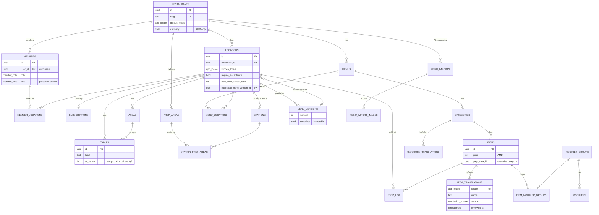
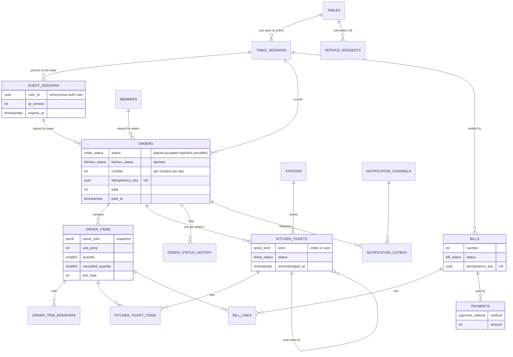
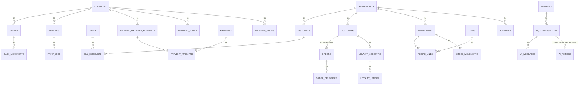

# Data model

The full schema for all four stages is real SQL, not a sketch: [`sql/10-schema.sql`](sql/10-schema.sql). It was applied to a clean Postgres 16 together with [`sql/00-supabase-stubs.sql`](sql/00-supabase-stubs.sql), a stand-in for Supabase's `auth`, `realtime` and `storage` schemas. Then [`sql/90-smoke-test.sql`](sql/90-smoke-test.sql) walked the Stage 1 flow as real roles; all 49 checks passed (list at the end). Phase 6 splits the file into Supabase migrations.

To re-run it on any Postgres 15+:

```bash
createdb ros_check
psql -d ros_check -v ON_ERROR_STOP=1 -f sql/00-supabase-stubs.sql -f sql/10-schema.sql -f sql/90-smoke-test.sql
# last line: ALL SMOKE TESTS PASSED
```

Never run `00-supabase-stubs.sql` against a Supabase project.

## Conventions

- Tenant key everywhere. Every tenant row has `restaurant_id`. Children reference parents with a composite key `(restaurant_id, parent_id) → parent(restaurant_id, id)`, so a row can't point at another café's row even if application code has a bug. The smoke test checks this.
- Restaurant is the tenant, location is the billing unit. A restaurant (brand, owner) has one or more locations (cafés). Subscriptions, tables, stations, counters and the published menu are per location.
- Money is `integer` AMD, whole drams, in every price, line and total. Ingredient costs in Stage 4 are the one exception (`numeric`, because 1 g of coffee costs 8.5 AMD).
- Guest-facing text lives in `*_translations` tables, one row per entity and language, with `source` (owner, ai, import) and `reviewed_at`. Order lines and published menus copy names in all three languages as `jsonb`.
- IDs are `uuid` (v4). Timestamps are `timestamptz`. Business dates are `date` in the location's timezone, rolling over at `business_day_starts` (05:00 by default, so a 01:30 order counts for the previous evening).
- State is a Postgres `enum`, transitions are enforced in functions, and every change lands in `order_status_history`.
- Clients write only what a plain form edits (menu, floor, settings). Orders, tickets, bills, payments and sessions change only through functions in `api` (staff, called with the user's JWT) or `private` (guest flows, called by our server). Details in `multi-tenancy-and-security.md`.

## ER diagrams

Three diagrams, by area. Columns shown are the ones that matter for relationships and rules; the SQL file has the rest.

### Tenancy, floor and menu (Stage 1)



### Orders, kitchen and money (Stage 1)



### Stages 2–4



## Tables by stage

68 tables in total. 46 are built in Stage 1. The Stage 2–4 tables exist in the target schema so that Stage 1 doesn't paint us into a corner; in Phase 6 they move to later migrations.

| Area | Tables | Stage |
|---|---|---|
| Tenancy and platform | `restaurants`, `locations`, `members`, `member_locations`, `invitations`, `device_pairings`, `platform_admins`, `subscriptions`, `audit_log` | 1 |
| Floor and kitchen setup | `areas`, `tables`, `prep_areas`, `stations`, `station_prep_areas`, `table_sessions` | 1 |
| Menu | `menus`, `menu_locations`, `categories`, `items`, `modifier_groups`, `modifiers`, `item_modifier_groups`, five `*_translations`, `stop_list`, `menu_versions` | 1 |
| AI onboarding | `menu_imports`, `menu_import_images` | 1 |
| Guests and orders | `guest_sessions`, `location_counters`, `orders`, `order_items`, `order_item_modifiers`, `order_status_history`, `service_requests` | 1 |
| Kitchen | `kitchen_tickets`, `kitchen_ticket_items` | 1 |
| Money (minimal) | `bills`, `bill_lines`, `payments` | 1 |
| Notifications | `notification_channels`, `telegram_link_codes`, `notification_outbox` | 1 |
| POS | `shifts`, `cash_movements`, `discounts`, `bill_discounts`, `printers`, `print_jobs` (and `members.pin_hash`, role `cashier`) | 2 |
| Online payments and own-site ordering | `payment_provider_accounts`, `payment_attempts`, `customers`, `location_hours`, `delivery_zones`, `order_deliveries` (and `orders.customer_id`, `fulfillment`) | 3 |
| Inventory, loyalty, AI assistant | `ingredients`, `recipe_lines`, `suppliers`, `stock_movements`, `loyalty_programs`, `loyalty_accounts`, `loyalty_ledger`, `ai_conversations`, `ai_messages`, `ai_actions` | 4 |

Not modelled on purpose: reservations (not in the roadmap), payroll, procurement documents, fiscal receipts (HDM; blocked on tax advice, see `docs/00-research/gaps.md`).

## Key modelling choices

A table session is the "check". When the first guest scans or the waiter opens table 5, a `table_session` opens (one open per table, enforced by a partial unique index). Every round of ordering is a separate `order` in that session, whether a guest or the waiter sent it. The waiter closes the session with one bill. Stage 2 split bills become several bills over the same session's lines.

An order is immutable after it's placed, except for cancellations. A guest who wants more coffee sends a new order. This keeps kitchen tickets simple and makes the offline outbox safe: there is never an "edit order 17" message that could conflict.

Kitchen routing goes through prep areas. Items (or their category) say what they need: Kitchen, Bar. Each location maps prep areas to its own screens (`station_prep_areas`), with a default station as fallback. A small café with one screen maps both areas to it; a bigger one has a bar screen. The smoke test checks that a coffee lands on the bar ticket and the khorovats on the kitchen ticket.

Kitchen tickets never change. Cancelling something after the kitchen started creates a `void` ticket that stays on the screen until a cook taps OK (`acknowledged_at`). If nothing on the ticket was started yet and everything is cancelled, the ticket just flips to `cancelled`. The URY reference uses the same approach.

Sizes are modifiers. "Small, medium, large" is a required modifier group with `min = max = 1` and price deltas. There's no variants table.

Published menus are snapshots. `api.publish_menu` copies the live menu of a location into `menu_versions.snapshot` (jsonb). Guests and waiters read only that, prices for orders are taken only from it, and the owner can edit the draft without guests seeing half-finished changes. The stop list (sold out) is applied live on top, so the kitchen can mark "out of dolma" without republishing. Publishing refuses while any AI-written translation is unreviewed.

The snapshot looks like this (trimmed from the smoke-test output):

```json
{
  "location_id": "…", "version": 1, "published_at": "…",
  "menus": [{ "id": "…", "name": {"hy": "Ճաշացանկ", "ru": "Меню", "en": "Menu"},
              "categories": [{ "id": "…", "name": {"hy": "Խմիչքներ", "en": "Drinks"}, "item_ids": ["6b60…"] }] }],
  "items": {
    "6b60…": { "name": {"hy": "Հայկական սուրճ", "en": "Armenian coffee"}, "price": 800,
               "prep_area_id": "…", "portion": null, "tags": [], "allergens": [], "image": null,
               "groups": [{ "id": "…", "min": 1, "max": 1, "name": {"hy": "Շաքար", "en": "Sugar"},
                            "modifiers": [{ "id": "…", "price_delta": 0, "name": {"hy": "Առանց շաքարի", "en": "No sugar"} },
                                          { "id": "…", "price_delta": 100, "name": {"hy": "Քաղցր", "en": "Sweet"} }] }] }
  }
}
```

## State machines

Three separate machines, as in nodedr: the order (did staff accept it), each kitchen ticket (where the food is) and the bill (is it paid). The guest sees one status derived from all three.

Order (`orders.status`)

| From | To | Who | How |
|---|---|---|---|
| (new) | `accepted` | system | Small QR orders when the location doesn't require acceptance; waiter orders always |
| (new) | `placed` | system | QR order above `max_auto_accept_total` (100,000 AMD by default) or location requires acceptance |
| `placed` | `accepted` | waiter, manager, owner | `api.accept_order`; kitchen tickets are created now |
| `placed` | `rejected` | waiter, manager, owner | `api.reject_order` (prank, wrong table) |
| `accepted` | `cancelled` | waiter, manager, owner | Automatic when every line is cancelled |

Kitchen ticket (`kitchen_tickets.status`, kind `order`)

| From | To | Who |
|---|---|---|
| `new` | `cooking` | kitchen, manager, owner |
| `new` | `ready` | kitchen, manager, owner (drinks with no cooking step) |
| `cooking` | `ready` | kitchen, manager, owner |
| `ready` | `cooking` | kitchen, manager, owner (undo a wrong "ready") |
| `ready` | `served` | waiter, kitchen, manager, owner |
| `new` | `cancelled` | automatic, when all its lines are cancelled before cooking starts |

`api.set_ticket_status(ticket, expected, next)` is compare-and-set. If the ticket is no longer in `expected`, it fails with `stale_status` (the app treats it as HTTP 409, refetches and tells the user). If it's already in `next`, it returns success, so an offline device replaying a tap does no harm.

Order kitchen status (`orders.kitchen_status`) is maintained by a trigger: it's the slowest live ticket of the order (`pending → cooking → ready → served`).

Bill (`bills.status`): `open → paid` or `void`. In Stage 1 `api.settle_table_session` creates the bill already paid, checks that payments add up to the total, closes the table session and revokes the guests' sessions.

What the guest sees (`public.order_display_status`):

| Condition | Guest sees |
|---|---|
| order rejected or cancelled | Rejected / Cancelled |
| `paid_at` set | Paid |
| kitchen status served / ready / cooking | Served / Ready / Cooking |
| order accepted, kitchen not started | Accepted |
| otherwise | Received |

This gives the brief's lifecycle, new → accepted → cooking → ready → served → paid, without packing three concerns into one column.

## Numbers people see

Order numbers restart every business day per location (`location_counters`), so the guest sees "Order 17", not a UUID. Kitchen tickets show the same number. Bills get their own daily sequence. Both are unique per `(location, business_date)`.

## What the smoke test proves

Run as real roles (owner A, owner B, a waiter tablet, a kitchen screen, two anonymous guests, our server):

- Tenant isolation: owner B sees none of café A's restaurants, menu, orders or realtime channel, and can't write to A's menu or publish it. A row can't reference another tenant's order (composite FK).
- AI review rule: publishing fails while AI translations are unreviewed and succeeds after review.
- Guest boundary: guests can't call server-only functions, read menu source tables, edit orders or see kitchen tickets. They see their own order and nobody else's, and can join only their own realtime channel.
- QR rotation: an old or forged QR version is refused. After the bill is settled, the old guest session can't order.
- Ordering: prices are computed on the server (2 × 3,500 + 2 × (800 + 100) = 8,800). Required modifier groups are enforced. Orders fan out to the kitchen and bar tickets. Lines keep the Armenian name for the kitchen, and a Telegram message is queued.
- Idempotency: replaying the same order returns the same order. Reusing a key with a different body is refused. Replaying the bill settlement returns the same bill.
- Kitchen flow: compare-and-set works, the replay is harmless, and roles are enforced (a waiter can't send food back to cooking). The order is "ready" only when every station's ticket is.
- Changes: cancelling after cooking started creates a void ticket and lowers the total. The kitchen acknowledges the void ticket.
- Money: the payments have to add up to the bill (8,800 + 1,600 = 10,400 in cash plus card).
- Abuse: the seventh guest order in 10 minutes is rate-limited.

## Left for Phase 6

- Stage 2–4 RLS policies. Until each stage ships, those tables have RLS on and no policy, which means no client access.
- The JSON shape of `menu_imports.draft` is defined with the Zod schema of the AI pipeline.
- `audit_log` and `order_status_history` will need monthly partitioning or archiving at roughly 200 cafés. They're plain tables until then.
- Generated TypeScript types (`supabase gen types`) replace hand-written row types.
- Columns added by later phases: ADR-033 (operations), ADR-036 (plans: `subscriptions.canceled_at`, `cancel_reason`, `converted_at`, plan check in ordering functions) and ADR-037 (`kitchen_tickets.first_seen_at`, `metrics_daily`).
- Functions designed but not yet written in SQL: service requests (create by guest through the server, acknowledge and resolve by staff), device pairing and invitations (server with service role, since they create auth users), applying a reviewed menu import, and the overdue-ticket and daily-summary jobs.
