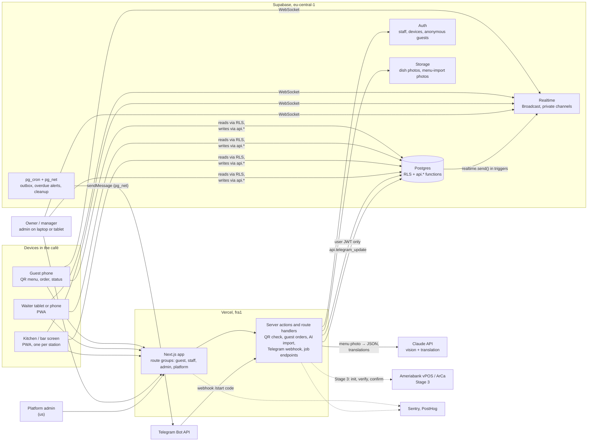

# Architecture overview

One Next.js app on Vercel, one Supabase project, and three outside services: Claude for menu import and translation, Telegram for alerts, and (Stage 3) an Armenian payment provider. No microservices, no separate API server, no queue product. Business rules live in Postgres functions, so the guest app, waiter app and kitchen screen all hit the same checks.

## System diagram

## Components

| Component | Runs on | Talks to | Notes |
|---|---|---|---|
| Guest app | Phone browser, no install | `api.public_menu` (anon), `api.guest_*` with its anonymous session, Realtime | Mobile-first, hy/ru/en. Menu is server-rendered from the published snapshot and cached per location. Sign-in is a silent anonymous session, created only when the guest orders or calls the waiter. |
| Waiter app | Tablet or phone, installable PWA | Supabase directly (RLS reads, `api.*` writes), Realtime | Table map, taking orders, accepting QR orders, marking served, closing the table. Offline outbox for safe actions (`realtime.md`). |
| Kitchen display | Tablet or TV browser, PWA | Supabase directly, Realtime | One URL per station. Columns New / Cooking / Ready, big type, sound, screen wake lock. |
| Owner admin | Laptop, tablet | Supabase directly, server actions | Menu editor, photo-to-menu import, publish, QR printing, staff and devices, sales dashboard, Telegram link. |
| Platform admin | Laptop | Server actions with platform-admin checks | Restaurants, subscriptions, support. Read access through RLS (`private.is_platform_admin()`). |
| Server actions / route handlers | Vercel functions (Node) | Supabase (always with the user's JWT), the AI provider, the Telegram webhook | Holds one secret, the AI provider key. No Supabase secret key (ADR-038). |
| Postgres | Supabase | — | RLS on every table, business rules in `api.*` and `private.*` functions, triggers for history, derived status and Realtime messages. |
| Realtime | Supabase | Clients over WebSocket | Database-originated Broadcast on private channels `loc:<location>` and `guest:<guest_session>`. Clients never send. |
| Storage | Supabase | Admin uploads, guest menu images | `menu-images` public, `menu-imports` private; paths start with `restaurant_id` and storage policies check it. |
| pg_cron + pg_net | Supabase | Telegram Bot API | Every minute: deliver and retry Telegram messages, flag overdue tickets. Nightly: delete old anonymous users (not devices), rate-limit rows, expired pairings. |
| Claude API | Anthropic | Called by server only | Vision extraction to strict JSON, then translation. Model choice and cost in Phase 2 and Phase 4. |
| Telegram Bot API | Telegram | pg_net (outgoing), our webhook route (incoming) | New-order and overdue alerts, daily summary. The webhook route passes updates to `api.telegram_update`, which checks the secret-token header against Vault. |
| Payment providers | Banks | Server only (Stage 3) | Hosted payment page, server-side verification, reconciliation job. |

## Where the rules live

| Layer | Owns | Does not own |
|---|---|---|
| Browser | Rendering, local cart, offline outbox, formatting | Prices, permissions, state transitions |
| Next.js server | Rendering, calling the AI provider, passing Telegram webhooks to the database | Business rules, QR signatures, any Supabase secret |
| Postgres | Who may read what (RLS), who may change what (`api.*` asserts), QR signatures (keys in Vault), prices from the published menu, state machines, idempotency, limits, history, outgoing Telegram calls (pg_net) | Calling the AI provider |

The server never uses the Supabase secret key (ADR-038). Every call it makes carries the user's own JWT, so RLS applies; guests and devices call `api.*` functions directly, and background jobs run inside Postgres.

## Main flows

Guest orders. Scan `/t/<token>` → server checks the HMAC signature (no database hit for garbage tokens) → menu page renders from the cached published snapshot → guest builds a cart → "Order" creates an anonymous session if there isn't one (behind Turnstile) → server action calls `private.join_table` then `private.place_guest_order` with an idempotency key → Postgres prices the order, creates kitchen tickets and queues a Telegram message → triggers send Realtime hints to `loc:<location>` and `guest:<session>`. Detailed flow diagrams come in Phase 3 (`docs/03-design/flows.md`).

Kitchen. The station screen is subscribed to `loc:<location>`. A `ticket` message arrives, the screen refetches its open tickets, plays a sound and shows the card. Taps call `api.set_ticket_status` with the expected status.

Owner onboarding. Sign up → `api.create_restaurant` (restaurant, first location, owner, default kitchen station, 30-day trial) → upload photos of the paper menu → server sends them to Claude, validates the JSON with Zod, translates the missing languages → owner reviews and edits the draft → apply creates menu rows marked `source = 'ai'` → owner marks each reviewed → `api.publish_menu` → print QR codes.

## Regions

Supabase in `eu-central-1` (Frankfurt) and Vercel functions in `fra1`, so the server and database sit in the same city. Frankfurt is the closest region both offer to Yerevan. Round-trip time from a Yerevan café network to Frankfurt has not been measured yet; that happens in Phase 4, because it decides whether the 2-second kitchen target has headroom.

## How later stages plug in

- Stage 2, POS and printing. Bills get split and discounts; shifts open and close. Printing happens from the browser over WebUSB or WebSerial (Chrome) using ReceiptPrinterEncoder, with Armenian rendered as images. Network printers need a small local bridge, because Vercel can't reach the café's LAN; we decide between the two after testing on real 58 mm and 80 mm printers. Fiscal receipts (HDM) are blocked on tax advice.
- Stage 3, payments and own-site ordering. Per-location provider credentials sit in Supabase Vault. Payment init and verification are server-only route handlers, plus a reconciliation job, because Ameria sends no webhook. Takeaway and delivery reuse `orders` with `fulfillment` and `order_deliveries`.
- Stage 4, inventory and AI assistant. Recipes deduct stock from sales in a trigger or nightly job. The owner assistant uses Claude tool calls that only propose actions (`ai_actions`); a member approves before anything changes.

See `decisions.md` for why each of these choices beat the alternatives.
