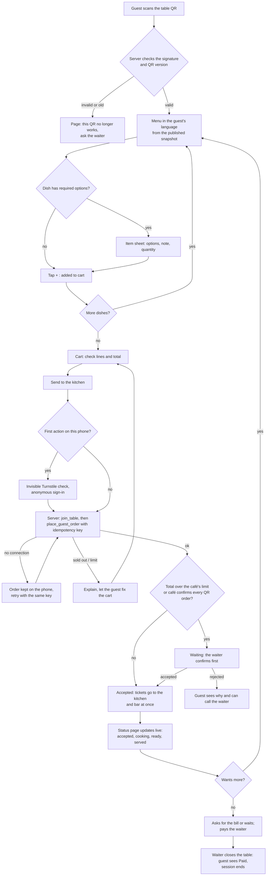
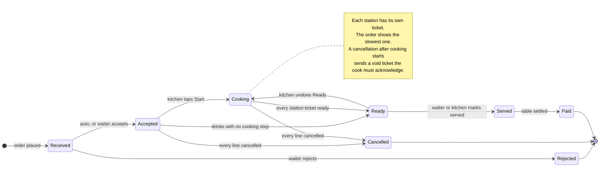
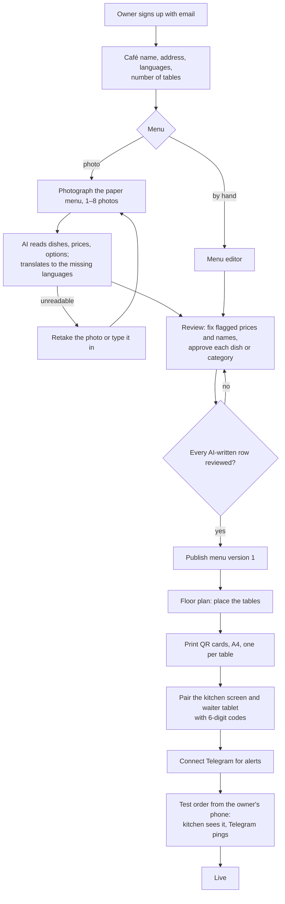
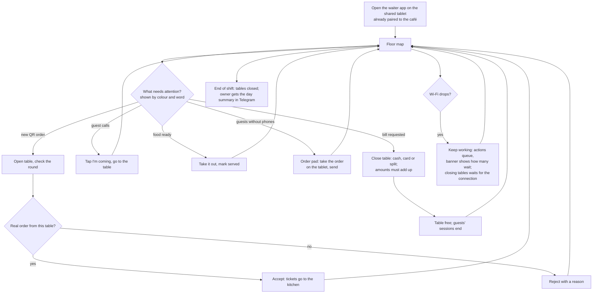

# Flows

Four flows from the brief. Statuses and function names match `docs/01-architecture/data-model.md`. All diagrams were rendered with Mermaid 11 to check the syntax.

## 1. Guest ordering

## 2. The life of an order

The guest's single status line comes from three machines: order acceptance, kitchen tickets per station, and the bill.

## 3. Owner onboarding (target: live in under 30 minutes)

## 4. A waiter's shift

